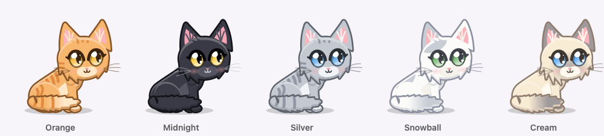
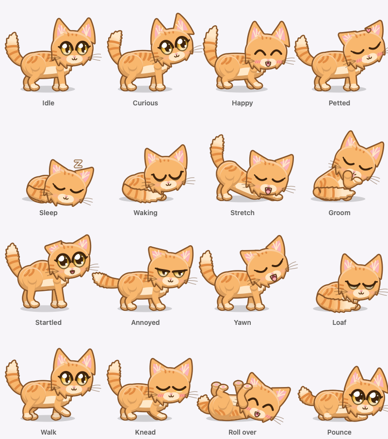

<p align="center">
  
</p>

<h1 align="center">Purrsistent</h1>

<p align="center">A tiny cat that lives on your Mac desktop and never quite leaves.</p>

---

Purrsistent is a native macOS desktop pet. A small animated cat strolls along the top of your Dock, naps, grooms, meows, and reacts when you stroke it, poke it, or toss it across the screen. It lives in a transparent, always-on-top window, so it stays out of your way: clicks on the empty space around it go straight through to the apps underneath.

<p align="center">
  
</p>

<p align="center">
  
</p>

## Features

- **Lives on your desktop**: walks along the top of the Dock (or the bottom of the screen), wanders across to your other monitors, and shows up on every Space and over full-screen apps.
- **Has a mind of its own**: idles, sits, grooms, yawns, scratches an itch, and wanders at random. It loafs when it's bored, gets visibly drowsy and dozes off after about 2 minutes without attention (sooner late at night), and wakes up slowly, often with a big stretch and a wash.
- **Plays**: a happy cat kneads, rolls onto its back, and chases its own tail.
- **Notices you**: its eyes follow your cursor when it's nearby, with the head turning a beat later, and it sometimes crouches, wiggles, and pounces at it. Hover over it and its ears perk up. Come back to your Mac after a few minutes away and it looks up to greet you, or wakes up if it was asleep.
- **Loves attention**: stroke it with the cursor and it closes its eyes and purrs. Click it for a happy hop and a meow, but poke it over and over and it gets annoyed. Poke it while it's asleep and it startles awake.
- **Throwable**: drag it and fling it. It flies, bounces off screen edges, and skids to a stop. A hard landing gives it a fright.
- **Treats and mood**: give it a fish treat and it looks up, then trots over to eat it. Its mood rises with attention and slowly fades when it's ignored, and a happier cat plays more.
- **Break reminders**: optionally reminds you to stretch, drink water, or rest your eyes. The cat looks up (waking first if it was asleep), meows, and its mouth moves as the speech bubble appears.
- **Coats**: Orange (tabby), Midnight (black with pink ears), Silver (grey tabby with blue eyes), Snowball (white with soft grey patches), and Cream (fluffy cream with grey points and blue eyes), or your own artwork.
- **Styles**: Anime (the default: a fluffy chibi kitten with big glossy eyes, cheek tufts, and cel shading, animated live), Cartoon, Pixel (chunky 32×32 pixel art), and Silhouette (a dark shape with glowing eyes). Any style works with any coat.
- **Sounds**: real cat recordings for meows, a surprised chirp, and a soft purr, plus a thud on landing. Pick a voice: Classic, Kitten, or Tomcat.
- **Stays out of the way**: no Dock icon, and clicks on transparent pixels pass through.
- **Menu bar controls**: everything is in the paw icon in the menu bar, or right-click the cat.

## Requirements

- macOS 13 Ventura or later
- Swift 5.9 or later. The Xcode Command Line Tools are enough (`xcode-select --install`); full Xcode isn't required.

## Build and run

```bash
./scripts/bundle.sh
open build/Purrsistent.app
```

`bundle.sh` builds a release binary, generates the app icon, copies any custom sprites and the sounds, and wraps everything into an ad-hoc signed `build/Purrsistent.app`. Move it to `/Applications` if you want to keep it.

For quick iteration during development you can also run it unbundled from the repo root:

```bash
swift run
```

## Using Purrsistent

| Action | What happens |
| --- | --- |
| Move the cursor near the cat | It watches the cursor; hovering over it perks its ears |
| Move the cursor back and forth over the cat | It purrs and its mood goes up |
| Click the cat | Happy hop and a meow |
| Click it four times in a few seconds | It gets annoyed: flattened ears, a sulky look, a flicking tail |
| Click it while it's asleep | It startles awake |
| Drag and release (or fling) the cat | It flies, bounces off edges, and lands with a thud (a hard landing startles it) |
| Right-click (or Control-click) the cat | Opens the menu |
| Click a speech bubble | Dismisses it |
| Leave it alone for ~2 minutes | It falls asleep and purrs (after ~45 seconds at night) |

The menu bar icon and the right-click menu offer the same options:

- **Show / Hide Pet**
- **Mood**: how the cat is feeling: Grumpy, Bored, Content, or Happy
- **Give Treat**: drops a fish for the cat to find and eat
- **Coat**: Orange, Midnight, Silver, Snowball, Cream, plus Custom when you've added your own sprites
- **Style**: Cartoon, Pixel, Silhouette, Anime (not available with the Custom coat)
- **Size**: Small, Medium, Large
- **Speed**: Slow, Normal, Fast
- **Stay Still**: no wandering, pouncing, or tail chasing; it still sits, grooms, stretches, loafs, and sleeps
- **Sounds** on/off
- **Voice**: Classic (a steady adult cat), Kitten (high, squeaky mews), Tomcat (a talkative tom), plus Custom when you've added your own sounds. Picking one plays a sample meow.
- **Volume**: Low, Medium, High
- **Break Reminders**: Off, or every 25, 45, or 60 minutes
- **Launch at Login**: only works from the bundled `.app`. If macOS refuses, the cat gives you a puzzled look along with the error.
- **Quit**

Settings and mood are saved between launches.

## The anime cat

<p align="center">
  
</p>

In the Anime style the cat isn't a flipbook: it's a jointed vector rig (hips, shoulders, two-segment legs, a curved tail, a big head with layered eyes) that is drawn fresh as it moves.

- **Behaviors** are keyframed poses. The cat eases from wherever it is into each new one instead of cutting, and big changes of pose take longer, so nothing snaps.
- **Life on top**: it breathes, blinks at irregular intervals with real eyelids (sometimes twice, slowly and lopsidedly when sleepy), and its ears and tail hang on springs, so they twitch, sway, and follow through on hops and landings.
- **Turning around**: the cat swings round through facing you, its body foreshortening and its legs gathering underneath, while the tail sweeps across to the other side. It isn't a flat flip.
- **Faces and particles**: wide eyes when surprised, a sulk when annoyed, a little "?" when something goes wrong, Zs while it sleeps, and hearts when it's happy or being stroked.
- **States**: idle, walking, sitting, loafing, getting drowsy, sleeping, waking, stretching, yawning, grooming, scratching, happy, petted, kneading, rolling over, tail chasing, curious, pouncing, eating, startled, annoyed, being carried, falling, and leaping.
- **Reduce Motion**: with **System Settings → Accessibility → Display → Reduce motion** on, hops and tail swishes are toned down and there are no hearts. It follows the setting live.
- **Light on your Mac**: it only redraws when something visibly changes, animates its sleep at a lower frame rate, and stops drawing entirely while its window is hidden or covered.

The other styles still use pre-drawn frames. With Custom sprites, the newer states reuse the closest animation you provided (waking uses `yawn`, curious uses `idle`, startled uses `fall`, annoyed uses `sit`).

## Custom artwork and sounds

Purrsistent's cat is drawn in code. Its sounds are real recordings in `Resources/Sounds/` (see [Credits](#credits)), with synthesized fallbacks built in, so it still works with no asset files at all. You can swap in your own.

### Sprites (`Resources/Sprites/`)

Put PNGs in `Resources/Sprites/`, rebuild, and pick **Coat → Custom**.

Animations: `idle`, `walk`, `sit`, `sleep`, `drag`, `fall`, `happy`, `petted`, `yawn`, `groom`, `eat`, `stretch`, `scratch`, `knead`, `rollOver`, `loaf`, `pounce` (the crouch and wiggle), `leap`, `tailChase`.

- Use a PNG sequence (`walk_0.png`, `walk_1.png`, ...) or a single horizontal strip of square frames (`walk.png`).
- Any animation you leave out falls back to the built-in cat.
- Draw the character **facing right**. Left-facing frames are mirrored automatically.
- Transparent pixels are click-through, so keep the background fully transparent.

To start from the built-in cat, export its frames (optionally in another coat or style) and edit them:

```bash
swift build
.build/debug/Purrsistent --export-sprites Resources/Sprites --coat silver --style anime
```

### Sounds (`Resources/Sounds/`)

Effects: `meow`, `chirp`, `thud`, `purr`.

Each voice has its own folder (`Classic/`, `Kitten/`, `Tomcat/`). Files in the selected voice's folder win; anything missing there comes from `Resources/Sounds/` itself, which holds the shared `purr` and `thud`. To use your own cat, put its sounds in `Resources/Sounds/Custom/`, rebuild, and pick **Voice → Custom**.

- Supported formats: `.wav`, `.aiff`, `.caf`, `.mp3`, `.m4a`.
- Add variations as `meow_0.wav`, `meow_1.wav`, ... and one is picked at random each time.
- `purr` loops while the cat sleeps or is being stroked, so it should loop cleanly.
- Any effect without a file falls back to a synthesized version.

After changing assets, run `./scripts/bundle.sh` again.

### Regenerating the defaults

```bash
swift build
.build/debug/Purrsistent --export-sounds SynthesizedSounds   # synthesized fallback sounds, for reference
.build/debug/Purrsistent --export-logo assets/logo.png
.build/debug/Purrsistent --export-anime-preview AnimePreview  # coat and state sheets, plus transition, turning, and blink strips
```

## Tests

```bash
./scripts/test.sh
```

The tests cover the behavior state machine (priorities, cooldowns, waking, startles) and the anime animation (that clips loop and blend without jumps, blinks use the eyelids, the gaze follows its target, Reduce Motion is respected, and unchanged frames aren't redrawn). The script passes `swift test` the extra flags it needs to find Swift Testing when only the Command Line Tools are installed; with Xcode, plain `swift test` works too.

## Project structure

```
Sources/Purrsistent/
  main.swift               App entry point and asset-export commands
  AppDelegate.swift        Wires up the pet and the menu bar
  PetWindow.swift          Transparent, always-on-top panel
  PetView.swift            Shows the current frame, mouse handling, pixel hit-testing
  PetController.swift      30 fps loop: movement, throwing, petting, treats, sound cues, and
                           feeding app events (cursor, clicks, speech, your return) to the cat
  PetStateMachine.swift    Behaviors with priorities, cooldowns, and weighted random transitions
  Mood.swift               Persisted mood that fades over time
  Treat.swift              The fish treat
  BubbleWindow.swift       Speech bubble above the pet
  BreakReminder.swift      Break reminder timer and messages
  SpriteAnimator.swift     Loads, mirrors, and steps through animation frames
  SpriteFactory.swift      Draws the built-in cat, its coats and styles, and the treat
  PixelArt.swift           Turns a vector drawing into pixel art
  CatAppearance.swift      Data-driven coats for the anime cat: colors, markings, eyes, fluffiness
  AnimeCatFactory.swift    Draws one pose of the rigged anime kitten: legs, fur tufts, eyes, cel shading
  AnimeCatClips.swift      Keyframed poses for every behavior
  AnimeCatAnimator.swift   Live animation: blending, breathing, blinks, gaze, springy ears and tail
  AnimeCatRenderer.swift   Rasterizes the live cat, skipping frames that wouldn't change
  AnimePreview.swift       Exports preview sheets of the anime cat
  SoundPlayer.swift        Loads and plays sound effects and loops
  SoundFactory.swift       Synthesizes fallback sounds
  IconFactory.swift        Draws the app icon and logo
  MenuBarController.swift  Menu bar icon and menu
  Settings.swift           Persisted preferences
Resources/
  Sprites/                 Optional custom animation frames
  Sounds/                  Shared purr and thud, plus one folder of meows and chirps per voice
Tests/PurrsistentTests/    State machine, animation, and rendering tests
scripts/bundle.sh          Builds Purrsistent.app
scripts/test.sh            Runs the tests
assets/                    Logo and images used in this README
```

## Roadmap

- Walking on top of app windows and sitting on the menu bar
- Reacting to system events like low battery
- More animals, not just cats

## Credits

The cat sounds are real recordings. Each was trimmed, faded, and loudness-matched, and the purr was cut into a seamless loop.

| Files | Source | Author | License |
| --- | --- | --- | --- |
| `Classic/meow_*` | [Cat_meow.wav](https://freesound.org/people/cribbler/sounds/511448/) | cribbler | [CC0 1.0](https://creativecommons.org/publicdomain/zero/1.0/) |
| `Classic/chirp_*` | [Cat Chirps.wav](https://freesound.org/people/Tyler31898/sounds/634174/) | Tyler31898 | [CC0 1.0](https://creativecommons.org/publicdomain/zero/1.0/) |
| `Kitten/*` | [Kitten meows](https://freesound.org/people/Luke100000/sounds/476918/) | Luke100000 | [CC0 1.0](https://creativecommons.org/publicdomain/zero/1.0/) |
| `Tomcat/*` | [Tom cat meow.wav](https://freesound.org/people/tosha73/sounds/506723/) | tosha73 | [CC0 1.0](https://creativecommons.org/publicdomain/zero/1.0/) |
| `purr_0` | [Purr (10 sec loopable).ogg](https://commons.wikimedia.org/wiki/File:Purr_(10_sec_loopable).ogg) | Insanejeff at English Wikipedia | Public domain |

The landing `thud` is synthesized by `SoundFactory.swift`.
